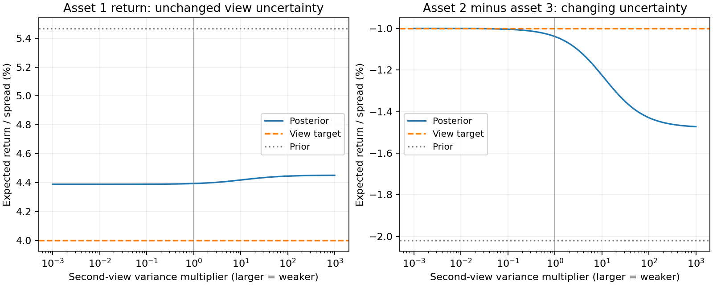

# Black-Litterman

**Goal:** translate two beliefs into matrix rows and inspect how uncertainty
controls the update. Read [Mean-variance](mean_variance.md) first.

Use one return horizon throughout. `pi` is an excess return; `mu_tilde` and the
absolute view in `Q` are total returns. `Omega` stores view-error **variances**,
not standard deviations. Larger entries represent less confidence.

Translated from `Examples/rpb/test_bl1.m`, which reproduces the example
on page 24 of Roncalli, T. (2013), *Introduction to Risk Parity and
Budgeting*.

Four assets, a market-cap-weighted reference portfolio `x`, and two
investor views: (1) asset 1's absolute return, (2) the *spread* between
asset 2 and asset 3's returns.

```python
import numpy as np
from quanttoolbox.linalg.special_matrices import xpnd
from quanttoolbox.stats.moments import corr_to_cov
from quanttoolbox.portfolio.black_litterman import (
    implied_risk_premia,
    black_litterman_moments,
)

sigma = np.array([0.15, 0.20, 0.25, 0.30])
rho_vech = np.array([1.00, 0.10, 1.00, 0.40, 0.70, 1.00, 0.50, 0.40, 0.80, 1.00])
rho = xpnd(rho_vech, method=1)
cov_matrix = corr_to_cov(sigma, rho)

x = np.array([0.40, 0.30, 0.20, 0.10])  # reference (e.g. market-cap) weights
r = 0.03  # risk-free rate
sharpe_ratio = 0.25  # assumed market Sharpe ratio

# Step 1: back out the implied equilibrium excess returns
irp = implied_risk_premia(x, cov_matrix, sharpe_ratio)
mu_tilde = r + irp.pi
print("implied pi:", np.round(100 * irp.pi, 2))
print("implied mu_tilde:", np.round(100 * mu_tilde, 2))

# Step 2: express the investor views
#   view 1: asset 1's return = 4%
#   view 2: asset 2's return - asset 3's return = -1%
P = np.array([[1, 0, 0, 0], [0, 1, -1, 0]], dtype=float)
Q = np.array([0.04, -0.01])
Omega = np.diag([0.10**2, 0.05**2])  # view uncertainty
tau = 1
gamma_matrix = tau * cov_matrix

# Step 3: blend the equilibrium prior with the views
bl = black_litterman_moments(mu_tilde, gamma_matrix, P, Q, Omega)
print("posterior mu_bar:", np.round(100 * bl.mu_bar, 2))
```

Output:

```text
implied pi: [2.47 3.68 5.7  6.06]
implied mu_tilde: [5.47 6.68 8.7  9.06]
posterior mu_bar: [4.39 6.64 7.68 7.61]
```

Notice how the posterior expected returns move toward the views: asset
1's posterior return (`4.39%`) shifts down from its equilibrium value
(`5.47%`) toward the view target (`4%`), and the asset‑2‑minus‑asset‑3
spread narrows from its equilibrium value toward the `-1%` view target,
with the joint update determined by the prior covariance and view uncertainty.
Correlations allow a view on one asset to change other assets too.


## Weaken the views

```python
weak_views = black_litterman_moments(mu_tilde, gamma_matrix, P, Q, 1e6 * Omega)
print("prior view returns:", np.round(P @ mu_tilde, 4))
print("posterior view returns:", np.round(P @ bl.mu_bar, 4))
print("view targets:", Q)
assert np.linalg.norm(weak_views.mu_bar - mu_tilde) < np.linalg.norm(bl.mu_bar - mu_tilde)
```

The posterior need not hit `Q` exactly: the views have finite uncertainty.
`gamma_matrix = tau * cov_matrix` is prior uncertainty about the mean;
it is distinct from the scalar return-reward `gamma` used in portfolio optimization.

## Change confidence in just one view

Keep the first view and the prior fixed. Multiply only the second view's
variance by the factor on the horizontal axis. Moving right means **less**
confidence in the belief that asset 2 underperforms asset 3 by one percentage point.



??? example "Python code for this figure (run blocks in page order)"

    ```python
    import matplotlib.pyplot as plt

    factors = np.logspace(-3, 3, 101)
    view_returns = []
    for factor in factors:
        uncertainty = Omega.copy()
        uncertainty[1, 1] *= factor
        posterior = black_litterman_moments(mu_tilde, gamma_matrix, P, Q, uncertainty)
        view_returns.append(P @ posterior.mu_bar)
    view_returns = np.array(view_returns)
    fig, axes = plt.subplots(1, 2, figsize=(10, 4), layout="constrained")
    for j, title in enumerate(
        ["Asset 1 return: unchanged view uncertainty", "Asset 2 minus asset 3: changing uncertainty"]
    ):
        axes[j].semilogx(factors, 100 * view_returns[:, j], label="Posterior")
        axes[j].axhline(100 * Q[j], color="tab:orange", linestyle="--", label="View target")
        axes[j].axhline(100 * (P @ mu_tilde)[j], color="gray", linestyle=":", label="Prior")
        axes[j].axvline(1, color="gray", linewidth=0.7)
        axes[j].set(
            xlabel="Second-view variance multiplier (larger = weaker)",
            ylabel="Expected return / spread (%)",
            title=title,
        )
        axes[j].legend(fontsize=9)
        axes[j].grid(alpha=0.2)
    plt.show()
    ```

With strong confidence, the second posterior spread approaches its target.
Weakening it leaves the prior and the first view to shape the result. The
first posterior return also moves: correlations couple the two updates, even
though the first view's own uncertainty never changes.
