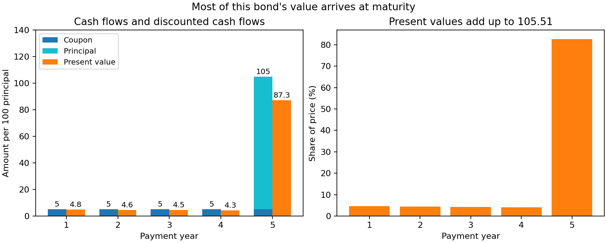
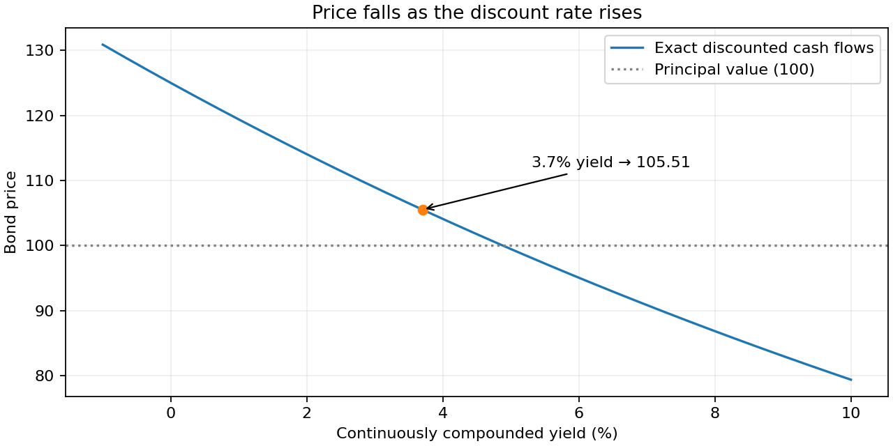
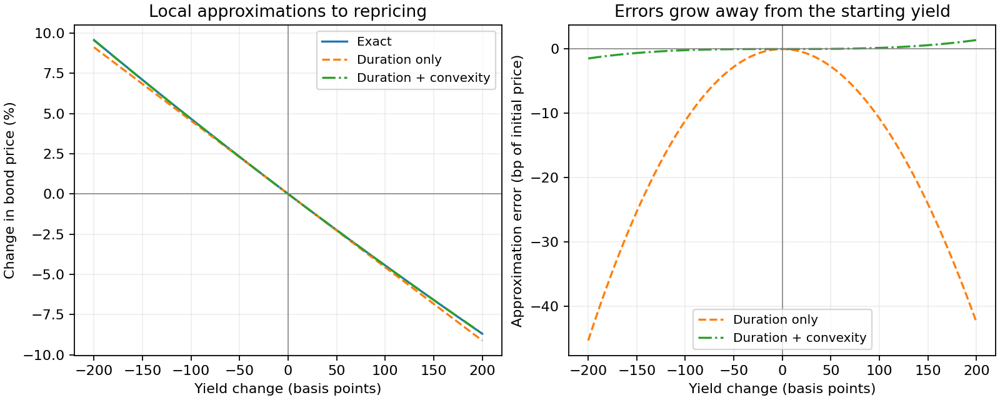

# Bond pricing: cash flows, yield, and approximation error

A bond exchanges a price today for payments in the future. We will price a
five-year bond, see which payments contribute most to its value, and compare
exact repricing with duration and convexity approximations.

Use the **same bond throughout**: principal 100, annual coupon 5, and a flat
3.7% continuously compounded yield. Time is in years; rates are decimals.

## From future payments to today's price

The final payment is 105: the last coupon plus principal. The chart separates
those two components and compares each payment with its discounted value.
The price is the sum of the orange bars, not the sum of the future payments.



??? example "Python code for this figure (run blocks in page order)"

    ```python
    import numpy as np
    import matplotlib.pyplot as plt
    from quanttoolbox.bond.pricing import (
        bond_price,
        bond_ytm,
        coupon_yield,
        bond_duration,
        bond_convexity,
    )

    t = np.arange(1.0, 6.0)
    coupons = np.full(5, 5.0)
    principal = np.array([0.0, 0.0, 0.0, 0.0, 100.0])
    cash_flows = coupons + principal
    rate = 0.037
    pv = cash_flows * np.exp(-rate * t)
    price = bond_price(t, cash_flows, rate, method=1)
    ytm = bond_ytm(t, cash_flows, price, method=1)
    assert np.isclose(price, pv.sum())
    assert np.isclose(ytm, rate)

    fig, axes = plt.subplots(1, 2, figsize=(10, 4), layout="constrained")
    axes[0].bar(t - 0.18, coupons, width=0.36, label="Coupon")
    axes[0].bar(t - 0.18, principal, bottom=coupons, width=0.36, label="Principal", color="tab:cyan")
    axes[0].bar(t + 0.18, pv, width=0.36, label="Present value", color="tab:orange")
    for year, payment, value in zip(t, cash_flows, pv, strict=True):
        axes[0].text(year - 0.18, payment + 2, f"{payment:.0f}", ha="center", fontsize=9)
        axes[0].text(year + 0.18, value + 2, f"{value:.1f}", ha="center", fontsize=9)
    axes[0].set(
        xlabel="Payment year",
        ylabel="Amount per 100 principal",
        title="Cash flows and discounted cash flows",
        xticks=t,
        ylim=(0, 140),
    )
    axes[0].legend(loc="upper left", fontsize=9)
    axes[1].bar(t, 100 * pv / price, color="tab:orange")
    axes[1].set(
        xlabel="Payment year",
        ylabel="Share of price (%)",
        xticks=t,
        title=f"Present values add up to {price:.2f}",
    )
    fig.suptitle("Most of this bond's value arrives at maturity")
    plt.show()
    ```

The price is **105.51**. About 83% comes from the year-five payment, so distant
cash flows dominate this bond's sensitivity to yield. The current yield,
`coupon_yield(t, cash_flows, rate)`, is about 4.74%: coupon divided by price.
It differs from the 3.7% yield to maturity, which accounts for all payments
and the redemption at 100.

## Higher yields mean lower prices

Reprice all five cash flows at each yield. The marked point is our starting
price; the horizontal line is principal value. The curved shape is important:
a straight-line approximation is only local.



??? example "Python code for this figure (run blocks in page order)"

    ```python
    yields = np.linspace(-0.01, 0.10, 161)
    prices = np.array([bond_price(t, cash_flows, y, method=1) for y in yields])
    fig, ax = plt.subplots(figsize=(8, 4), layout="constrained")
    ax.plot(100 * yields, prices, label="Exact discounted cash flows")
    ax.axhline(100, color="gray", linestyle=":", label="Principal value (100)")
    ax.scatter([100 * rate], [price], color="tab:orange", zorder=3)
    ax.annotate(
        f"3.7% yield → {price:.2f}",
        (100 * rate, price),
        xytext=(5.3, 112),
        arrowprops={"arrowstyle": "->"},
    )
    ax.set(
        xlabel="Continuously compounded yield (%)",
        ylabel="Bond price",
        title="Price falls as the discount rate rises",
    )
    ax.legend()
    ax.grid(alpha=0.2)
    plt.show()
    ```

## How much does the approximation miss?

Duration gives the tangent line at the starting yield. Convexity adds the
curvature term. Both are calculated for the **same coupon bond and continuous
compounding convention** used above:

`relative price change ≈ -duration × yield change + ½ × convexity × yield change²`

The left panel compares changes in price. The right panel magnifies the signed
error, **approximation minus exact**, in basis points of the initial price.
One basis point here is 0.01% of 105.51; it is not a basis point of yield.



??? example "Python code for this figure (run blocks in page order)"

    ```python
    duration = bond_duration(t, cash_flows, rate, method=1)
    convexity = bond_convexity(t, cash_flows, rate, method=1)
    shifts = np.linspace(-0.02, 0.02, 201)  # -200 to +200 yield basis points
    exact = np.array([bond_price(t, cash_flows, rate + dr, method=1) for dr in shifts]) / price - 1
    linear = -duration * shifts
    quadratic = linear + 0.5 * convexity * shifts**2
    assert np.isclose(exact[100], 0)
    assert np.max(np.abs(quadratic - exact)) < np.max(np.abs(linear - exact))

    fig, axes = plt.subplots(1, 2, figsize=(10, 4), layout="constrained")
    for values, label, style in [
        (exact, "Exact", "-"),
        (linear, "Duration only", "--"),
        (quadratic, "Duration + convexity", "-."),
    ]:
        axes[0].plot(10000 * shifts, 100 * values, style, label=label)
    axes[0].set(ylabel="Change in bond price (%)", title="Local approximations to repricing")
    axes[0].legend(fontsize=9)
    axes[1].plot(
        10000 * shifts, 10000 * (linear - exact), "--", color="tab:orange", label="Duration only"
    )
    axes[1].plot(
        10000 * shifts,
        10000 * (quadratic - exact),
        "-.",
        color="tab:green",
        label="Duration + convexity",
    )
    axes[1].set(
        ylabel="Approximation error (bp of initial price)",
        title="Errors grow away from the starting yield",
    )
    axes[1].legend(fontsize=9)
    for ax in axes:
        ax.set_xlabel("Yield change (basis points)")
        ax.axhline(0, color="gray", linewidth=0.7)
        ax.axvline(0, color="gray", linewidth=0.7)
        ax.grid(alpha=0.2)
    plt.show()
    ```

Duration alone understates the price for moves in either direction because
the price curve is convex. Adding convexity substantially reduces the error
over this range, but does not make a finite Taylor expansion exact. Both
approximations meet the exact curve at zero yield change.

## Compounding and schedule conventions

`method=1` discounts continuously; `method=2` compounds annually and requires
a yield above -100%. Use the same method for pricing, yield, duration, and
convexity. The functions value the supplied payments; they do not construct
coupon schedules or adjust for accrued interest. The first-payment/price
ratio is an annual current yield only when that first payment is an annual
coupon without principal.

## Sector-level modified-duration/DTS risk

A 3-bond portfolio split across two sectors, penalized for deviating
its per-sector modified duration (MD) and duration-times-spread (DTS)
from targets, plus a linear carry term.

```python
from quanttoolbox.bond.pricing import bond_portfolio_quadratic_form

sector = np.array([1, 1, 2])  # bonds 0,1 in sector 1; bond 2 in sector 2
md = np.array([2.0, 4.0, 6.0])  # modified duration per bond
md_star = np.array([3.0, 6.0])  # per-sector MD target
dts = np.array([1.0, 1.0, 2.0])  # duration-times-spread per bond
dts_star = np.array([1.0, 2.0])  # per-sector DTS target
carry = np.array([0.01, 0.02, 0.03])  # carry per bond
w = np.array([0.5, 0.25, 0.25])  # portfolio weights

result = bond_portfolio_quadratic_form(
    sector,
    varphi_md=0.7,
    md=md,
    md_star=md_star,
    varphi_dts=0.3,
    dts=dts,
    dts_star=dts_star,
    gamma_carry=1.0,
    carry=carry,
    w=w,
)
print("risk (qf):", result.qf)
```

Output:

```text
risk (qf): 7.766875000000001
```

`result.md`/`result.dts` are the individual
`sustainable_finance.risk.QuadraticFormResult` terms the combined
`(q, r, c)` was built from — each sector's contribution is broken out
in `q_j`/`r_j`/`c_j` on those objects.
`bond_portfolio_quadratic_form_vs_benchmark` extends this with an
active-share term against a benchmark weight vector; see its docstring
for the full parameterization.

This sector objective is a penalty score, not a bond price or a volatility.
The cash-flow and repricing charts above describe a single instrument; this
optional extension measures portfolio deviations from sector targets.
