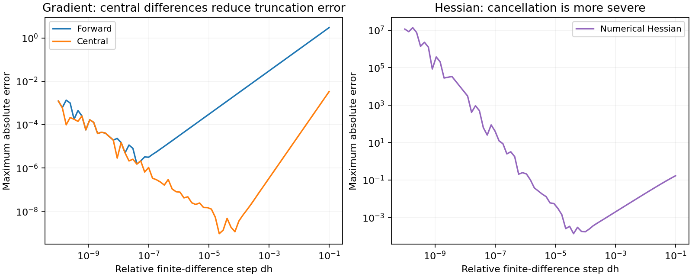

# Building blocks: bisection, linear algebra, numerical differentiation

**Goal:** verify numerical tools against identities you can calculate yourself.
You need NumPy arrays, matrix multiplication, and basic differentiation.
Each check below tests meaning, not just whether the function returns.

Smaller, self-contained examples for the lower-level utilities other
modules are built on.

## Bisection root-finding

Translated from `Examples/optim/bisection1.m`.

```python
import numpy as np
from quanttoolbox.optim.bisection import bisection


def f(x):
    return x**2 - 4.0


assert f(0.0) * f(10.0) < 0  # bracket a sign change for this continuous function
root = bisection(f, 0.0, 10.0)
assert np.isclose(f(root), 0.0, atol=1e-7)
print(root)  # -> 2.0 (the positive root of x^2 = 4, within the bracket [0, 10])
```

## Explicit ↔ implicit linear constraint conversion

Translated from `Examples/optim/explicit1.m`. Converts between an explicit
constraint `C @ x = c` and an implicit null-space parametrization
`x = R @ r + r0`.

```python
from quanttoolbox.optim.bisection import explicit_to_implicit, implicit_to_explicit

CC = np.array([[1.0, 0, 0, 0, 0, 0, 0, 0]])  # constraint: x[0] = 1
c = np.array([1.0])

RR, r = explicit_to_implicit(CC, c)
print("R shape:", RR.shape)  # (8, 7) -- 7 free directions in the null space
CC2, c2 = implicit_to_explicit(RR, r)
# Different bases or rescalings can describe the same feasible set.
x_feasible = RR @ np.arange(7, dtype=float) + r
assert np.allclose(CC @ x_feasible, c)
assert np.allclose(CC2 @ x_feasible, c2)
```

## `vec`/`vech`/`xpnd`

Translated from `Examples/matrix/vec1.m` and `vech1.m`.

```python
import numpy as np
from quanttoolbox.linalg.special_matrices import vec, vech, xpnd, reshapec

x = np.random.default_rng(0).standard_normal((3, 3))
y = vec(x)  # column-major flatten
back = reshapec(y, 3, 3)  # and back
assert np.allclose(x, back)

# vech/xpnd: half-vectorization of a symmetric matrix and its inverse
xs = np.random.default_rng(0).standard_normal((5, 5))
xs = (xs + xs.T) / 2  # symmetry is essential for this round trip
v = vech(xs, method=1)  # lower-triangle, row-wise order
back = xpnd(v, method=1)  # expands back to a full symmetric matrix
assert np.allclose(xs, back)
```

## Numerical gradient and Hessian

Translated from `Examples/maths/grad1.m` and `hess1.m`. Compares the
numerical derivative of `f(x) = 3x² + 6x + 7 + log(x)` against its known
analytical derivative `f'(x) = 6x + 6 + 1/x`.

```python
from quanttoolbox.maths.numerical_diff import numerical_gradient, numerical_hessian


def fun_sum(x):
    return np.sum(3 * x**2 + 6 * x + 7 + np.log(x))


def grad_analytical(x):
    return 6 * x + 6 + 1 / x


x0 = np.arange(1, 11, dtype=float)
g_numerical = numerical_gradient(fun_sum, x0, method="forward")
g_true = grad_analytical(x0)
print("max abs error:", np.max(np.abs(g_true - g_numerical)))
```


The default forward step gives a maximum absolute gradient error around
`1e-5` here. That is an absolute error, not a universal number of significant
digits. Check curvature separately:

```python
h_numerical = numerical_hessian(fun_sum, x0)
h_true = np.diag(6 - 1 / x0**2)
print("Hessian max absolute error:", np.max(np.abs(h_true - h_numerical)))
assert np.allclose(g_numerical, g_true, rtol=1e-5, atol=1e-5)
assert np.allclose(h_numerical, h_true, rtol=1e-3, atol=1e-3)
```

## Smaller steps eventually make derivatives worse

Sweep the relative step `dh` rather than selecting one value. Each curve is
the largest absolute discrepancy from the analytical derivative above.
The gradient and Hessian have different units, so compare methods within
each panel rather than their heights across panels.



??? example "Python code for this figure (run blocks in page order)"

    ```python
    import matplotlib.pyplot as plt

    steps = np.logspace(-10, -1, 70)
    fig, axes = plt.subplots(1, 2, figsize=(10, 4), layout="constrained")
    for method in ["forward", "central"]:
        errors = [
            np.max(np.abs(numerical_gradient(fun_sum, x0, dh=h, method=method) - g_true)) for h in steps
        ]
        axes[0].loglog(steps, errors, label=method.capitalize())
    h_errors = [np.max(np.abs(numerical_hessian(fun_sum, x0, dh=h) - h_true)) for h in steps]
    axes[1].loglog(steps, h_errors, color="tab:purple", label="Numerical Hessian")
    axes[0].set(title="Gradient: central differences reduce truncation error")
    axes[1].set(title="Hessian: cancellation is more severe")
    for ax in axes:
        ax.set(xlabel="Relative finite-difference step dh", ylabel="Maximum absolute error")
        ax.grid(which="both", alpha=0.15)
        ax.legend(fontsize=9)
    plt.show()
    ```

At large steps (right), truncation error dominates. At tiny steps (left),
subtracting nearly equal floating-point values amplifies rounding error.
The lowest part of each curve is the useful region for this function and
scale, not a universal step size. All perturbed logarithm arguments remain positive.
