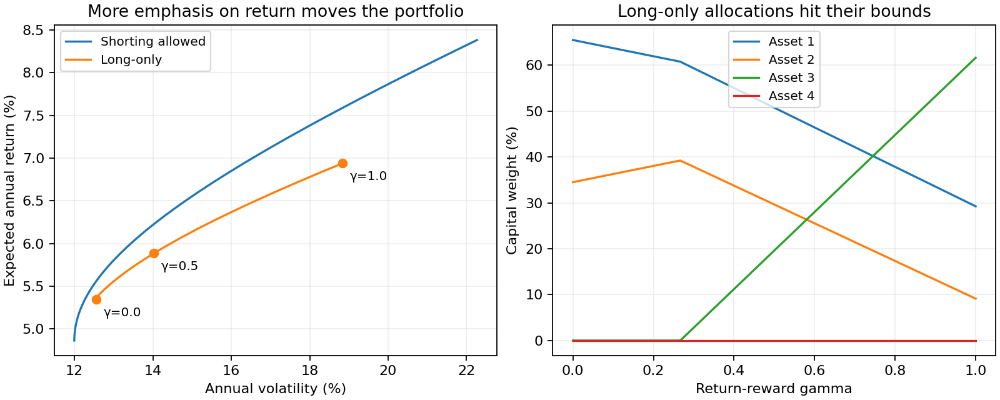

# Mean-variance, minimum-variance, and tracking error

**Goal:** understand how the objective and allocation constraints change a portfolio.
Read [Building blocks](building_blocks.md) first if covariance matrices are new to you.

All returns and volatilities below use the same annual horizon, in decimals.
The objective minimizes `0.5 * w @ cov @ w - gamma * mu @ w`:
**larger gamma puts more weight on return**. It is an inverse risk-aversion
convention. The default budget is `sum(w)=1`; short positions are allowed.

Translated from `Examples/rpb/test_mvo1.m`, `test_minvar1.m`, `test_te1.m`.
Same four-asset dataset as the [Black-Litterman example](black_litterman.md).

```python
import numpy as np
from quanttoolbox.linalg.special_matrices import xpnd
from quanttoolbox.stats.moments import corr_to_cov
from quanttoolbox.portfolio.mean_variance import mvo_portfolio, minvar_portfolio
from quanttoolbox.portfolio.tracking_error import minimum_te_portfolio

mu = np.array([0.05, 0.06, 0.08, 0.06])
sigma = np.array([0.15, 0.20, 0.25, 0.30])
rho_vech = np.array([1.00, 0.10, 1.00, 0.40, 0.70, 1.00, 0.50, 0.40, 0.80, 1.00])
rho = xpnd(rho_vech, method=1)
cov_matrix = corr_to_cov(sigma, rho)

# --- Mean-variance optimal, return-reward gamma=0.5 ---
mvo = mvo_portfolio(mu, cov_matrix, gamma=0.5)
print("MVO weights:", np.round(mvo.weights, 4))
print("expected return:", round(mvo.expected_return, 5), "volatility:", round(mvo.volatility, 5))

# --- Minimum-variance (gamma=0 case) ---
minvar = minvar_portfolio(cov_matrix)
print("MinVar weights:", np.round(minvar.weights, 4))
print("MinVar volatility:", round(minvar.volatility, 5))

# --- Minimum tracking error vs. an equally-weighted benchmark ---
x_benchmark = np.full(4, 0.25)
te = minimum_te_portfolio(x_benchmark, cov_matrix)
print("Min-TE weights:", np.round(te.weights, 4))
print("tracking error:", round(te.tracking_error, 6))
```

Output:

```text
MVO weights: [ 0.6209  0.1417  0.6221 -0.3848]
expected return: 0.06623 volatility: 0.15228
MinVar weights: [ 0.7274  0.4946 -0.2045 -0.0175]
MinVar volatility: 0.11995
Min-TE weights: [0.25 0.25 0.25 0.25]
tracking error: 0.0
```

Note the minimum-tracking-error solution (with no return tilt, `gamma=0`)
correctly returns exactly the benchmark weights — zero tracking error is
achievable trivially by holding the benchmark itself, and the optimizer
finds it.


## Check the constraints, then change one

Negative weights are short positions. A portfolio can sum to one while having
gross exposure `sum(abs(w))` greater than one. Add bounds to make the comparison
long-only, keeping the same inputs and objective:

```python
long_only = mvo_portfolio(mu, cov_matrix, gamma=0.5, lb=0.0, ub=1.0)
print("long-only weights:", np.round(long_only.weights, 4))
print(
    "gross exposure, signed / long-only:",
    np.abs(mvo.weights).sum(),
    np.abs(long_only.weights).sum(),
)
assert np.isclose(mvo.weights.sum(), 1.0)
assert np.isclose(long_only.weights.sum(), 1.0)
assert np.min(long_only.weights) >= -1e-7
assert np.allclose(te.weights, x_benchmark, atol=1e-6)
```

## Watch the allocation move along the frontier

Only gamma changes in each curve. Both portfolios must sum to one; one permits
shorting and the other does not. The weight chart shows why a smooth change
in the objective can push an asset to its zero-weight bound.



??? example "Python code for this figure (run blocks in page order)"

    ```python
    import matplotlib.pyplot as plt

    gammas = np.linspace(0, 1, 61)
    signed = [mvo_portfolio(mu, cov_matrix, gamma=g) for g in gammas]
    positive = [mvo_portfolio(mu, cov_matrix, gamma=g, lb=0.0, ub=1.0) for g in gammas]
    weights = np.array([p.weights for p in positive])
    assert np.allclose(weights.sum(axis=1), 1)
    assert weights.min() >= -1e-7
    fig, axes = plt.subplots(1, 2, figsize=(10, 4), layout="constrained")
    for portfolios, label in [(signed, "Shorting allowed"), (positive, "Long-only")]:
        axes[0].plot(
            [100 * p.volatility for p in portfolios],
            [100 * p.expected_return for p in portfolios],
            label=label,
        )
    for i in [0, 30, 60]:
        p = positive[i]
        axes[0].scatter(100 * p.volatility, 100 * p.expected_return, color="tab:orange")
        axes[0].annotate(
            f"γ={gammas[i]:.1f}",
            (100 * p.volatility, 100 * p.expected_return),
            xytext=(5, -12),
            textcoords="offset points",
            fontsize=9,
        )
    axes[0].set(
        xlabel="Annual volatility (%)",
        ylabel="Expected annual return (%)",
        title="More emphasis on return moves the portfolio",
    )
    axes[0].legend(fontsize=9)
    for j in range(4):
        axes[1].plot(gammas, 100 * weights[:, j], label=f"Asset {j + 1}")
    axes[1].set(
        xlabel="Return-reward gamma",
        ylabel="Capital weight (%)",
        title="Long-only allocations hit their bounds",
    )
    axes[1].legend(fontsize=9)
    for ax in axes:
        ax.grid(alpha=0.2)
    plt.show()
    ```

Gamma zero minimizes variance. Increasing gamma rewards expected return,
changing both risk and weights; it does not increase every holding. The
long-only constraint narrows the available choices. These curves describe
model expectations, not realized investment performance.
