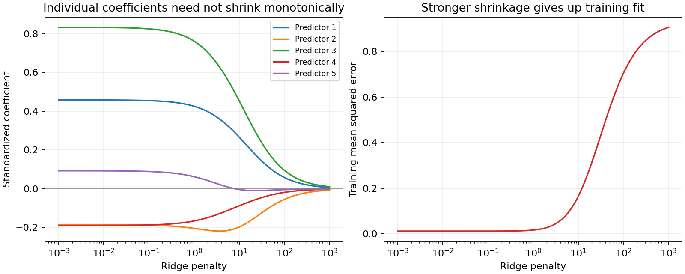
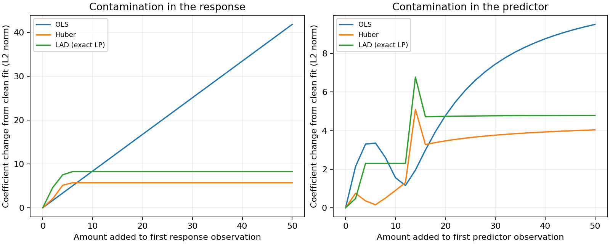

# Ridge regression path

**Goal:** distinguish regularization from robust loss functions.
First fit standardized predictors with a ridge penalty; then change the loss
used to handle response outliers. Familiarity with least squares is enough.

This is a training-data demonstration. For predictive evaluation, split the
data first and learn centering/scaling from the training set only.

Translated from `Examples/stats/ridge1.m`. A small standardized dataset
(15 observations, 5 predictors); the example shows how the coefficient norm
shrinks toward zero as the penalty `lambda` increases.

```python
import numpy as np
from quanttoolbox.stats.regression.ols import standardize
from quanttoolbox.stats.regression.ridge import ridge

data = np.array(
    [
        [3.1, 2.8, 4.3, 0.3, 2.2, 3.5],
        [24.9, 5.9, 3.6, 3.2, 0.7, 6.4],
        [27.3, 6.0, 9.6, 7.6, 9.5, 0.9],
        [25.4, 8.4, 5.4, 1.8, 1.0, 7.1],
        [46.1, 5.2, 7.6, 8.3, 0.6, 4.5],
        [45.7, 6.0, 7.0, 9.6, 0.6, 0.6],
        [47.4, 6.1, 1.0, 8.5, 9.6, 8.6],
        [-1.8, 1.2, 9.6, 2.7, 4.8, 5.8],
        [20.8, 3.2, 5.0, 4.2, 2.7, 3.6],
        [6.8, 0.5, 9.2, 6.9, 9.3, 0.7],
        [12.9, 7.9, 9.1, 1.0, 5.9, 5.4],
        [37.0, 1.8, 1.3, 9.2, 6.1, 8.3],
        [14.7, 7.4, 5.6, 0.9, 5.6, 3.9],
        [-3.2, 2.3, 6.6, 0.0, 3.6, 6.4],
        [44.3, 7.7, 2.2, 6.5, 1.3, 0.7],
    ]
)
y = standardize(data[:, 0])
x = standardize(data[:, 1:6])

for lam in [0.0, 1.0, 10.0]:
    beta, df, complexity = ridge(y, x, lambda_=lam)
    mse = np.mean((y - x @ beta) ** 2)
    print(f"lambda={lam}: beta={np.round(beta, 3)}, df={round(df, 2)}, mse={round(mse, 4)}")
```

Output:

```text
lambda=0.0: beta=[ 0.459 -0.185  0.834 -0.189  0.093], df=5.0, mse=0.0118
lambda=1.0: beta=[ 0.426 -0.205  0.762 -0.166  0.063], df=4.59, mse=0.0164
lambda=10.0: beta=[ 0.267 -0.198  0.454 -0.088 -0.004], df=2.77, mse=0.1648
```

`lambda=0` recovers plain OLS exactly (5 effective degrees of freedom,
one per coefficient); as `lambda` grows, the coefficient norm and effective degrees of freedom
decrease, while training MSE increases. Individual coefficient magnitudes
need not decrease monotonically: inspect the second coefficient above.
Ridge usually does not produce exact zeros. A test set is needed to assess
whether this loss of training fit improves prediction.

## See the entire ridge path



??? example "Python code for this figure (run blocks in page order)"

    ```python
    import matplotlib.pyplot as plt

    penalties = np.logspace(-3, 3, 90)
    coefficients = np.array([ridge(y, x, lambda_=lam)[0] for lam in penalties])
    training_mse = np.mean((y[:, None] - x @ coefficients.T) ** 2, axis=0)
    fig, axes = plt.subplots(1, 2, figsize=(10, 4), layout="constrained")
    for j in range(x.shape[1]):
        axes[0].semilogx(penalties, coefficients[:, j], label=f"Predictor {j + 1}")
    axes[0].axhline(0, color="gray", linewidth=0.7)
    axes[0].set(
        xlabel="Ridge penalty",
        ylabel="Standardized coefficient",
        title="Individual coefficients need not shrink monotonically",
    )
    axes[0].legend(fontsize=8)
    axes[1].semilogx(penalties, training_mse, color="tab:red")
    axes[1].set(
        xlabel="Ridge penalty",
        ylabel="Training mean squared error",
        title="Stronger shrinkage gives up training fit",
    )
    for ax in axes:
        ax.grid(alpha=0.2)
    plt.show()
    ```

The second coefficient initially moves further from zero. Shrinkage applies
to the overall coefficient norm, not monotonically to every coordinate.
The training-error curve cannot tell us which penalty predicts best.

## OLS and robust regression

Translated from `Examples/ects/ols1.m` and `Examples/ects/robust1.m`,
which share the same small dataset.

```python
from quanttoolbox.econometrics.estimation import ols_estimation
from quanttoolbox.stats.regression.robust import huber_regression, lad_regression

data = np.array(
    [
        [1.5, 1.0, 2.4, 3.6, 0.3],
        [20.4, 1.0, 1.1, 3.8, 5.9],
        [17.1, 1.0, 5.1, 6.3, 6.1],
        [30.9, 1.0, 2.7, 2.4, 9.5],
        [22.2, 1.0, 3.3, 3.0, 7.4],
        [9.1, 1.0, 1.0, 5.4, 4.9],
        [39.2, 1.0, 9.6, 2.8, 8.1],
        [3.1, 1.0, 2.9, 4.4, 1.0],
        [7.2, 1.0, 4.2, 5.6, 1.7],
        [27.6, 1.0, 8.1, 1.7, 5.4],
    ]
)
y, x = data[:, 0], data[:, 1:5]

result = ols_estimation(y, x)
print("OLS beta:", np.round(result.beta, 4))
print("R2:", round(result.r_squared, 4))

print("Huber beta:", np.round(huber_regression(y, x, c=1.345).beta, 4))
print("LAD beta:", np.round(lad_regression(y, x).beta, 4))
```

Output:

```text
OLS beta: [ 3.4461  1.5442 -1.6454  2.8951]
R2: 0.9913
Huber beta: [ 3.4144  1.5276 -1.7484  2.8624]
LAD beta: [ 2.3756  1.8841 -1.7415  2.9071]
```

## A controlled outlier experiment

Keep the predictors fixed and add one response outlier. Compare each method
with its own clean-data fit; the norms measure sensitivity, not forecasting quality.

```python
y_contaminated = y.copy()
y_contaminated[0] += 50.0
fitters = {
    "OLS": lambda response: ols_estimation(response, x).beta,
    "Huber": lambda response: huber_regression(response, x, c=1.345).beta,
    "LAD": lambda response: lad_regression(response, x).beta,
}
for name, fit in fitters.items():
    change = np.linalg.norm(fit(y_contaminated) - fit(y))
    print(f"{name}: coefficient change = {change:.3f}")
```

## Move the outlier and watch the fit respond

Sweep a response outlier in the left panel. In the right panel, instead move
one predictor value while keeping that observation's response fixed. The
horizontal axes have different units; the panels demonstrate two distinct
ways an observation can affect the fit.



??? example "Python code for this figure (run blocks in page order)"

    ```python
    from quanttoolbox.stats.regression.quantile import quantile_regression


    # Use the exact median-regression LP for LAD so iteration limits do not
    # masquerade as changes in sensitivity along the curve.
    def fitted_coefficients(response, design):
        huber = huber_regression(response, design, c=1.345)
        return [
            ols_estimation(response, design).beta,
            huber.beta,
            quantile_regression(response, design, 0.5)[0],
        ], huber.converged


    baseline, _ = fitted_coefficients(y, x)
    response_shifts = np.linspace(0, 50, 26)
    predictor_shifts = np.linspace(0, 50, 26)
    fig, axes = plt.subplots(1, 2, figsize=(10, 4), layout="constrained")
    for ax, shifts, which in zip(
        axes, [response_shifts, predictor_shifts], ["response", "predictor"], strict=True
    ):
        changes, huber_ok = [], []
        for shift in shifts:
            response, design = y.copy(), x.copy()
            if which == "response":
                response[0] += shift
            else:
                design[0, 1] += shift  # first non-intercept predictor
            estimates, converged = fitted_coefficients(response, design)
            changes.append(
                [np.linalg.norm(b - original) for b, original in zip(estimates, baseline, strict=True)]
            )
            huber_ok.append(converged)
        changes = np.array(changes)
        for j, name in enumerate(["OLS", "Huber", "LAD (exact LP)"]):
            ax.plot(shifts, changes[:, j], label=name)
        unfinished = ~np.array(huber_ok)
        if unfinished.any():
            ax.scatter(
                shifts[unfinished],
                changes[unfinished, 1],
                marker="x",
                color="black",
                label="Huber iteration limit",
                zorder=4,
            )
        ax.set(
            xlabel=f"Amount added to first {which} observation",
            ylabel="Coefficient change from clean fit (L2 norm)",
            title=f"Contamination in the {which}",
        )
        ax.legend(fontsize=8)
        ax.grid(alpha=0.2)
    plt.show()
    ```

A robust response loss limits some effects of a large response residual.
It does not automatically protect against an observation whose predictor
values give it high leverage. These curves measure coefficient sensitivity,
not out-of-sample accuracy; any crosses flag unfinished Huber iterations.
