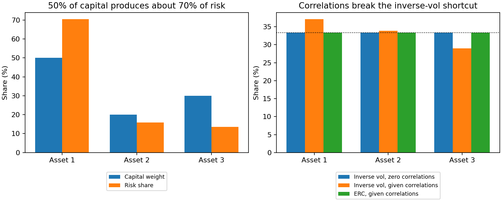

# Risk budgeting: ERC, VaR, and ES contributions

**Goal:** distinguish an asset's capital weight from its share of portfolio risk.
Read [Mean-variance](mean_variance.md) first for covariance construction.

Returns and covariance use one consistent horizon. VaR and ES below assume
Gaussian returns with zero mean; they are parametric loss measures, not an
empirical tail backtest. Multiplying by 100 changes decimals to percent.

Translated from `Examples/rpb/test_erc1.m`, which reproduces Tables 2.2,
2.3, and 2.4 (pages 81–82) of Roncalli, T. (2013), *Introduction to Risk
Parity and Budgeting*.

Three assets with given volatilities and correlations; a fixed
(non-equal-risk) weight vector `x = [0.50, 0.20, 0.30]`. The example
computes the risk contribution decomposition under three different risk
measures: plain volatility, 99% VaR, and 99% Expected Shortfall.

```python
import numpy as np
from quanttoolbox.linalg.special_matrices import xpnd
from quanttoolbox.stats.moments import corr_to_cov
from quanttoolbox.portfolio.risk_budgeting import (
    risk_contribution,
    risk_contribution_var,
    risk_contribution_es,
)

sigma = np.array([0.30, 0.20, 0.15])
rho_vech = np.array([1.00, 0.80, 1.00, 0.50, 0.30, 1.00])
rho = xpnd(rho_vech, method=1)
cov_matrix = corr_to_cov(sigma, rho)

x = np.array([0.50, 0.20, 0.30])

# --- Volatility-based risk contribution ---
rc_vol = risk_contribution(x, cov_matrix)
print("portfolio volatility:", round(100 * rc_vol.risk, 2))
print("pct risk contribution:", np.round(100 * rc_vol.pct_risk_contribution, 2))

# --- VaR-based (99% confidence) ---
mu = np.zeros(3)
alpha = 0.99
rc_var = risk_contribution_var(x, cov_matrix, mu, alpha)
print("99% VaR:", round(100 * rc_var.risk, 2))

# --- ES-based (99% confidence) ---
rc_es = risk_contribution_es(x, cov_matrix, mu, alpha)
print("99% ES:", round(100 * rc_es.risk, 2))
```

Output:

```text
portfolio volatility: 20.87
pct risk contribution: [70.43 15.93 13.64]
99% VaR: 48.55
99% ES: 55.62
```

The `20.87%` portfolio volatility and the `[70.43, 15.93, 13.64]` percent
risk contribution split match the published Table 2.2 values at the displayed precision.

## Equal Risk Contribution portfolio

The same covariance matrix, but solving *for* the weights that make each
asset's risk contribution equal (rather than decomposing a given,
unequal weight vector):

```python
from quanttoolbox.portfolio.risk_budgeting import erc_portfolio

erc = erc_portfolio(cov_matrix)
print("ERC weights:", np.round(erc.weights, 4))
print("pct risk contribution:", np.round(100 * erc.pct_risk_contribution, 2))
```

Output:

```text
ERC weights: [0.1969 0.3244 0.4787]
pct risk contribution: [33.33 33.33 33.33]
```

Each asset contributes one-third of volatility within solver tolerance.
The less volatile asset receives more capital, but correlations matter too.

```python
assert np.isclose(rc_vol.pct_risk_contribution.sum(), 1.0)
assert np.isclose(erc.weights.sum(), 1.0)
assert np.allclose(erc.pct_risk_contribution, np.full(3, 1 / 3), atol=1e-5)
```

## Compare money allocated with risk contributed

The first panel compares capital weights with risk shares for the original
portfolio. The second holds inverse-volatility weights fixed while adding
correlations, then shows how ERC restores equal risk contributions.



??? example "Python code for this figure (run blocks in page order)"

    ```python
    import matplotlib.pyplot as plt

    inverse_vol = (1 / sigma) / np.sum(1 / sigma)
    diagonal_cov = np.diag(sigma**2)
    independent = risk_contribution(inverse_vol, diagonal_cov).pct_risk_contribution
    correlated = risk_contribution(inverse_vol, cov_matrix).pct_risk_contribution
    assert np.allclose(independent, 1 / 3)
    asset = np.arange(3)
    fig, axes = plt.subplots(1, 2, figsize=(10, 4), layout="constrained")
    axes[0].bar(asset - 0.18, 100 * x, width=0.36, label="Capital weight")
    axes[0].bar(asset + 0.18, 100 * rc_vol.pct_risk_contribution, width=0.36, label="Risk share")
    axes[0].set(title="50% of capital produces about 70% of risk")
    for offset, shares, label in [
        (-0.25, independent, "Inverse vol, zero correlations"),
        (0, correlated, "Inverse vol, given correlations"),
        (0.25, erc.pct_risk_contribution, "ERC, given correlations"),
    ]:
        axes[1].bar(asset + offset, 100 * shares, width=0.25, label=label)
    axes[1].axhline(100 / 3, color="black", linestyle=":", linewidth=1)
    axes[1].set(title="Correlations break the inverse-vol shortcut")
    for ax in axes:
        ax.set(xticks=asset, xticklabels=["Asset 1", "Asset 2", "Asset 3"], ylabel="Share (%)")
        ax.legend(fontsize=8, loc="upper center", bbox_to_anchor=(0.5, -0.12))
    plt.show()
    ```

Inverse-volatility weighting equalizes risk when the covariance is diagonal.
With these correlations it no longer does, even though the capital weights
are unchanged. ERC changes the holdings to restore one-third risk shares.
