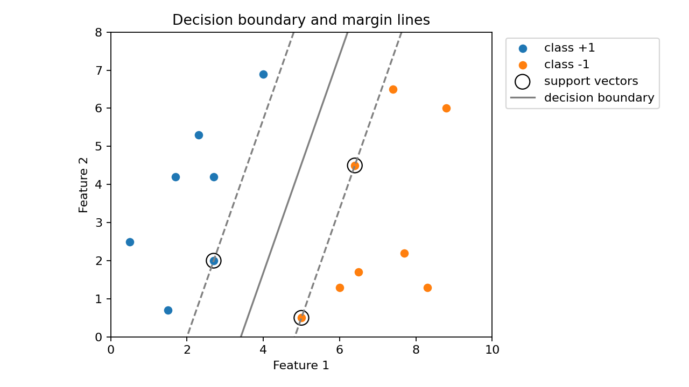
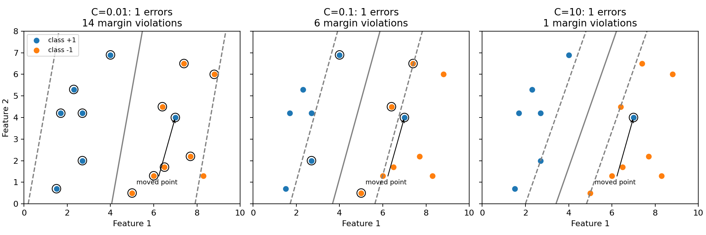

# SVM classification (hard margin)

**Goal:** connect decision scores, support vectors, and geometric distance.
The inputs are two raw features and labels -1/+1. This hard-margin example
requires linear separability. Feature scaling changes the geometry.

Translated from `Examples/svm/svm1.m`. 15 points in 2-D, two linearly
separable classes.

```python
import numpy as np
from quanttoolbox.svm.svm import svm_classification_primal

data = np.array(
    [
        [0.5, 2.5, 1],
        [2.7, 4.2, 1],
        [2.7, 2.0, 1],
        [1.7, 4.2, 1],
        [1.5, 0.7, 1],
        [2.3, 5.3, 1],
        [4.0, 6.9, 1],
        [6.4, 4.5, -1],
        [7.7, 2.2, -1],
        [8.8, 6.0, -1],
        [7.4, 6.5, -1],
        [6.5, 1.7, -1],
        [8.3, 1.3, -1],
        [6.0, 1.3, -1],
        [5.0, 0.5, -1],
    ]
)
y, x = data[:, 2], data[:, 0:2]

result = svm_classification_primal(y, x, c=None)  # c=None -> hard margin
print("beta0:", round(result.beta0, 6))
print("beta:", np.round(result.beta, 6))
print("geometric half-margin:", round(1 / np.linalg.norm(result.beta), 6))

# A signed score of one lies on a margin boundary; above one is beyond it.
scores = result.beta0 + x @ result.beta
signed_scores = y * scores
support_vectors = np.flatnonzero(np.isclose(signed_scores, 1.0, atol=1e-5))
assert np.all(signed_scores >= 1.0 - 1e-5)
assert np.array_equal(np.sign(scores), y)
print("support vector indices:", support_vectors)
```

Output:

```text
beta0: 2.415929
beta: [-0.707965  0.247788]
geometric half-margin: 1.3332
support vector indices: [ 2  7 14]
```

Three points lie on the margin boundaries. The others lie beyond the margin
band and have signed scores greater than one. The distance from the decision
line to either margin line is `1 / ||beta||`; the full band width is twice that.
The legacy `result.margin` field returns `1 / (beta @ beta)`, the **square** of
the geometric half-margin, so we calculate the distance explicitly above.

## Draw the geometry



??? example "Python code for this figure (run blocks in page order)"

    ```python
    import matplotlib.pyplot as plt

    fig, ax = plt.subplots(figsize=(8, 4.5))
    for label, color in [(1, "tab:blue"), (-1, "tab:orange")]:
        mask = y == label
        ax.scatter(x[mask, 0], x[mask, 1], color=color, label=f"class {label:+d}")
    ax.scatter(
        x[support_vectors, 0],
        x[support_vectors, 1],
        s=150,
        facecolors="none",
        edgecolors="black",
        label="support vectors",
    )
    x1 = np.linspace(0, 10, 200)
    for score, style in [(0, "-"), (-1, "--"), (1, "--")]:
        x2 = (score - result.beta0 - result.beta[0] * x1) / result.beta[1]
        ax.plot(x1, x2, style, color="gray", label="decision boundary" if score == 0 else None)
    ax.set(
        xlabel="Feature 1",
        ylabel="Feature 2",
        xlim=(0, 10),
        ylim=(0, 8),
        title="Decision boundary and margin lines",
    )
    ax.set_aspect("equal", adjustable="box")
    ax.legend(loc="upper left", bbox_to_anchor=(1.02, 1.0))
    fig.tight_layout()
    plt.show()
    ```

## Soft margins: compare penalties on the same data

Move one positive point into the other class's region, then keep that dataset
fixed. Each panel changes only `c`. Circles mark observations inside the
margin or misclassified; the title distinguishes those two cases.



??? example "Python code for this figure (run blocks in page order)"

    ```python
    x_soft = x.copy()
    x_soft[0] = [7.0, 4.0]
    xx, yy = np.meshgrid(np.linspace(0, 10, 180), np.linspace(0, 8, 150))
    fig, axes = plt.subplots(1, 3, figsize=(12, 4), layout="constrained", sharex=True, sharey=True)
    for ax, penalty in zip(axes, [0.01, 0.1, 10.0], strict=True):
        soft = svm_classification_primal(y, x_soft, c=penalty)
        signed = y * (soft.beta0 + x_soft @ soft.beta)
        violations = signed < 1 - 1e-5
        errors = signed < 0
        grid_scores = soft.beta0 + soft.beta[0] * xx + soft.beta[1] * yy
        ax.contour(xx, yy, grid_scores, levels=[-1, 0, 1], colors="gray", linestyles=["--", "-", "--"])
        for label, color in [(1, "tab:blue"), (-1, "tab:orange")]:
            mask = y == label
            ax.scatter(x_soft[mask, 0], x_soft[mask, 1], color=color, label=f"class {label:+d}")
        ax.scatter(
            x_soft[violations, 0], x_soft[violations, 1], s=110, facecolors="none", edgecolors="black"
        )
        ax.annotate(
            "moved point", (7, 4), xytext=(5.2, 0.9), fontsize=8, arrowprops={"arrowstyle": "->"}
        )
        ax.set(
            xlabel="Feature 1",
            xlim=(0, 10),
            ylim=(0, 8),
            title=f"C={penalty:g}: {errors.sum()} errors\n{violations.sum()} margin violations",
        )
        ax.set_aspect("equal", adjustable="box")
    axes[0].set_ylabel("Feature 2")
    axes[0].legend(fontsize=8, loc="upper left")
    plt.show()
    ```

A larger `c` makes violations more expensive, but does not guarantee that every
point can be classified correctly. A point can be correctly classified and
still lie inside the margin: its signed score is between zero and one.
