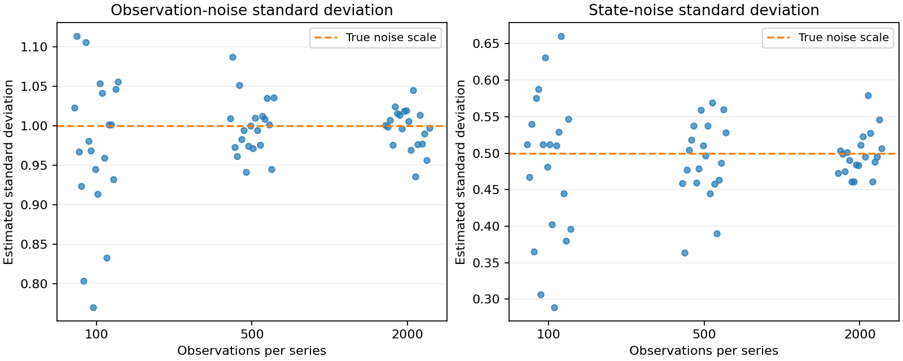

# Whittle (frequency-domain) estimation

**Goal:** estimate two noise scales from a simulated time series with known
parameters. Read the periodogram examples in the [catalog](index.md#numerical-mathematics)
first if frequency-domain representations are unfamiliar.

Whittle estimation fits a parametric spectral density to a periodogram using
an approximate likelihood. It provides a different route to estimation from
the time-domain Kalman likelihood.

## Local-level model

A local-level (random-walk-plus-noise) model, `y_t = mu_t + eps_t`,
`mu_t = mu_{t-1} + eta_t`, is fit by maximizing the Whittle
approximate log-likelihood of the first-differenced series against the
model's spectral density — recovering `(sigma_epsilon, sigma_eta)`
without ever running a Kalman filter.

```python
import numpy as np
from quanttoolbox.econometrics.whittle import whittle_local_level

# Simulate a local-level series with known standard deviations
rng = np.random.default_rng(0)
n = 500
sigma_epsilon_true, sigma_eta_true = 1.0, 0.5
mu = np.cumsum(sigma_eta_true * rng.standard_normal(n))
y = mu + sigma_epsilon_true * rng.standard_normal(n)

result = whittle_local_level(y, sv=np.array([1.0, 1.0]))
print("estimated (sigma_epsilon, sigma_eta):", np.round(result.theta, 4))
print("converged:", result.converged)
print("stderr:                             ", np.round(result.stderr, 4))
print("true      (sigma_epsilon, sigma_eta):", [sigma_epsilon_true, sigma_eta_true])
```

Output:

```text
estimated (sigma_epsilon, sigma_eta): [0.9144 0.5254]
converged: True
stderr:                              [0.0424 0.0495]
true      (sigma_epsilon, sigma_eta): [1.0, 0.5]
```

These are **standard deviations**, not variances. The observation-noise
estimate is about two estimated standard errors below its true value; the
state-noise estimate is about half a standard error above. A single simulation
does not guarantee recovery within any particular interval.

```python
truth = np.array([sigma_epsilon_true, sigma_eta_true])
print("estimation error / stderr:", np.round((result.theta - truth) / result.stderr, 2))
assert result.converged
assert np.all(np.isfinite(result.stderr))
```

## See sampling variation across repeated series

One series can give an unusually high or low estimate. Here each dot is a
new fit, using 20 fixed seeds at each sample size. The dashed line is the
simulation truth, not another estimate. Larger samples should generally
concentrate the estimates, although a small experiment need not improve
monotonically for every seed.



??? example "Python code for this figure (run blocks in page order)"

    ```python
    import matplotlib.pyplot as plt

    sample_sizes = [100, 500, 2000]
    estimates = np.empty((3, 20, 2))
    converged = np.empty((3, 20), dtype=bool)
    for i, size in enumerate(sample_sizes):
        for seed in range(20):
            simulation = np.random.default_rng(seed + 100)
            level = np.cumsum(sigma_eta_true * simulation.standard_normal(size))
            observations = level + sigma_epsilon_true * simulation.standard_normal(size)
            fit = whittle_local_level(observations, sv=np.array([1.0, 1.0]))
            estimates[i, seed] = fit.theta
            converged[i, seed] = fit.converged
    assert np.isfinite(estimates).all()
    fig, axes = plt.subplots(1, 2, figsize=(10, 4), layout="constrained")
    offsets = np.linspace(-0.14, 0.14, 20)  # spread dots; no additional randomness
    for j, title in enumerate(
        ["Observation-noise standard deviation", "State-noise standard deviation"]
    ):
        for i in range(3):
            good = converged[i]
            axes[j].scatter(i + offsets[good], estimates[i, good, j], alpha=0.7, color="tab:blue", s=22)
            if (~good).any():
                axes[j].scatter(i + offsets[~good], estimates[i, ~good, j], marker="x", color="red")
        axes[j].axhline(truth[j], color="tab:orange", linestyle="--", label="True noise scale")
        axes[j].set(
            xticks=range(3),
            xticklabels=sample_sizes,
            xlabel="Observations per series",
            ylabel="Estimated standard deviation",
            title=title,
        )
        axes[j].legend(fontsize=9)
        axes[j].grid(axis="y", alpha=0.2)
    plt.show()
    print("Converged fits per sample size:", converged.sum(axis=1))
    ```

The spread of dots shows sampling variation that a single fitted result hides.
Red crosses, if present, retain fits that did not converge rather than silently
excluding them. Twenty repetitions illustrate the mechanism; they do not
establish confidence-interval coverage.

## Custom spectral densities

`whittle_estimation` takes an arbitrary `sdf_fn(lambda, theta)` — the
built-in `whittle_local_level`/`whittle_local_linear_trend` are thin
wrappers around it. The [`econometrics.whittle` API
reference](../api/econometrics.md) has a full worked example fitting a
4th-order Bloomfield exponential spectral density (Dzhaparidze, 1986) to
a real 500-observation series, with an analytical Jacobian passed
through for faster convergence — see the `whittle2.py` example there for
the complete, live-synced source.

## Where this comes from

Both examples above are simplified/simulated versions of the same
model the original toolbox's `Examples/ects/whittle1.m` fits to a real
71-observation "Purse" series (Harvey, 1990, *Forecasting, Structural
Time Series and the Kalman Filter*, pages 89-90) — see the
`econometrics.md` API page for that exact translated example, which
reproduces the textbook numbers directly.
